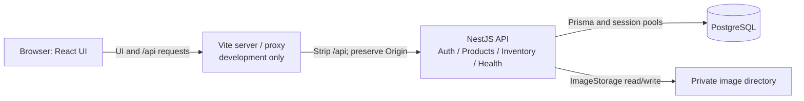

# OrderFlow

OrderFlow is a single-business product and inventory application. Administrators
maintain the catalog and stock records; operators browse products and inventory.
Order creation and reservations are planned, not implemented.

This documentation follows the merged implementation baseline in
[project status](docs/project-status.md). **Inventory frontend 4C is implemented
only on an unmerged local branch**, not on the main frontend documented here.

Merged capabilities include session login/logout, current-role authorization,
exact ARS prices, catalog create/read/edit/archive, primary image management and
the inventory backend with immutable, idempotent adjustments. The React UI covers
authentication, catalog and images. Positive stock prevents archival.

## Architecture overview

React/Vite and strict TypeScript form the frontend. NestJS is a modular monolith
using Prisma/pg and PostgreSQL 17; images use Multer, sharp and private disk storage.
There is no worker, Redis or generic repository layer.



The browser uses HttpOnly session cookies and memory-only CSRF tokens. Image reads
also pass through authenticated API routes. Vite's proxy is **not production
hosting**; production needs a same-origin HTTPS proxy, persistent storage and an
operational deployment plan. See [architecture](docs/architecture.md).

## Quick start

Prerequisites: Node **24.22.0**, pnpm **10.34.7**, and an accessible Docker daemon
with Compose v2 supporting `up --wait`. No version manager is assumed.

First follow [environment and local PostgreSQL](docs/development.md#environment-and-local-postgresql):
preserve an existing `.env`, replace example placeholders locally, confirm database
credentials/volume ownership, configure trusted origins and optionally private image
storage. Then run from the repository root:

```sh
pnpm install --frozen-lockfile
docker compose up -d --wait postgres
pnpm db:generate
pnpm db:migrate
pnpm users:provision:dev
pnpm dev
```

Migrations and provisioning mutate the selected development database. Provisioning
creates or validates accounts; it never resets existing passwords, roles or status.
Run `pnpm dev:web` in another terminal. Open http://127.0.0.1:5173; the API listens
on http://127.0.0.1:3000 by default. Use your local configured credentials.
Ctrl-C stops each application process; `docker compose stop postgres` preserves data.

The [command reference](docs/development.md) covers runtime selection, every workspace
script, isolated tests, health checks, migration authoring, image cleanup and recovery.
Do not use application data as a test database.

## Reading map

| Document                                                           | Use it for                                                                   |
| ------------------------------------------------------------------ | ---------------------------------------------------------------------------- |
| [Project status](docs/project-status.md)                           | Baseline SHAs, merged vs local work, evidence, debt and next-task acceptance |
| [Feature guide](docs/features.md)                                  | Roles, user workflows, security boundaries and API entry points              |
| [Architecture](docs/architecture.md)                               | Module/data responsibilities, persistence and inventory sequence diagram     |
| [Development and operations](docs/development.md)                  | Setup, commands, testing, troubleshooting, storage and safe stopping         |
| [Catalog and image contract](docs/product-catalog.md)              | Exact requests, responses, validation, pagination and image lifecycle rules  |
| [Inventory contract](docs/inventory.md)                            | Balances/history, transactions, locks and idempotency                        |
| [UI design](docs/ui-design.md)                                     | Burgundy tokens, hierarchy, responsive behavior, focus and limitations       |
| [Product scope](docs/product-scope.md), [roadmap](docs/roadmap.md) | Business requirements and future acceptance criteria                         |
| [ADRs](docs/decisions/0001-backend-foundation.md)                  | Decisions 0001–0006, alternatives, consequences and historical follow-ups    |
| [Contributing](CONTRIBUTING.md)                                    | Human development, focused commits and protected integration workflow        |

Production account provisioning, deployment/restore drills, orders, reservations,
payments and tenant isolation remain outside the implemented scope. Historical CI
and browser evidence is linked by SHA in project status; it is not a claim of
production readiness or complete accessibility compliance.
